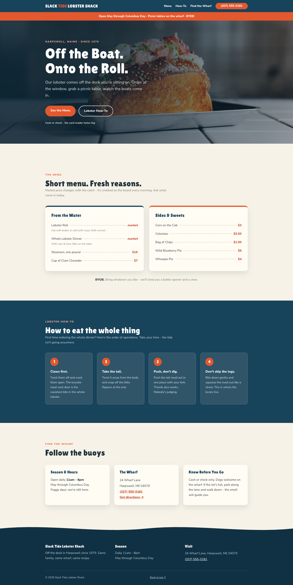

# Maine_Lobster_Restaurant
Responsive restaurant website built to showcase a Maine-based restaurant through a custom front-end experience.

# 📋 Link 
https://yummyeatsmaine.netlify.app/

# 📷 Images

# ✨ Features
Fully responsive design for desktop and mobile.         

# 🔨 Built With
HTML5 – structure,    
CSS3 – responsive design and background,    
JavaScript - handling different click events. 
